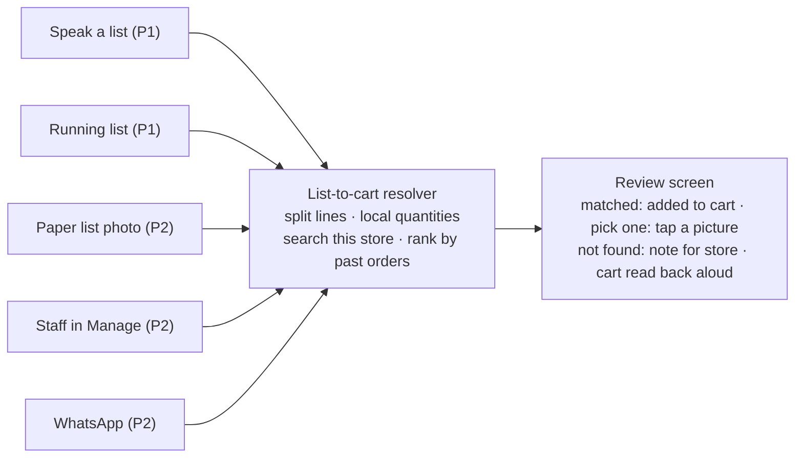

# Easy Shopping — Plan

Oct 20, 2026 · Live doc (batch status tracked there): https://claude.ai/code/artifact/c3668e8e-dcd5-42ca-b7a6-05731e356d30

## Goal

A customer who can't type or search should still be able to place a full grocery order: by speaking, by photographing a paper list, or by tapping "same as last time". Everything below serves one aim: fewer screens, fewer taps, no typing.

**Principles**

- One shared engine turns any loose input into a cart. Every input method is a thin layer over it.
- Never order silently. The customer always sees, and hears, the matched cart before paying.
- Tamil comes first. Local words for quantities and brand nicknames must work from day one.
- Fall back to a person. When matching is unsure, the store can call the customer instead of guessing.

**What success looks like**

- At least 80% of spoken or written lines match the right product without the customer fixing them.
- Customers who order by voice or photo come back the next month at least as often as those who search.
- Store staff take fewer phone orders by hand, because those customers order through the app or WhatsApp.

## Shared core: list-to-cart resolver

One API endpoint takes a loose list, as text, and returns a cart the customer can review. Voice, photo, WhatsApp and the running list all feed it. Build it first; everything else depends on it.

Each new input is just a way to get text into the resolver; the review screen is the same for all of them.

**What already exists and gets reused**

| Piece | Where | Reuse |
| --- | --- | --- |
| AI order chat with Claude tool use | `apps/api/src/routes/ai/index.ts`, `apps/mobile/app/ai-order.tsx` | Its `search_products` tool and prompt rules seed the resolver |
| Voice input in the app language | `apps/mobile/lib/use-voice-input.ts` (`expo-speech-recognition`) | Already listens in Tamil or English |
| Store search with spelling fixes | `services/store-search.ts`, `services/spell.ts` | Candidate lookup per line |
| Search intents and Tamil product names | subcategory `searchTerms`, translated catalog | Matches "அரிசி" and nicknames |
| Reorder predictions from past orders | `services/reorder.ts`, `routes/smart-reorder` | Picks the brand and size the customer usually buys |
| Photo picking | `expo-image-picker` | Phase 2 photo list |

**How a list becomes a cart**

1. **Split** the text into lines: one item, one quantity, one unit. Claude does this step, because people speak and write in run-on sentences.
2. **Normalise local quantities**: kaal kilo = 250 g, arai kilo = 500 g, "10 rupees of curry leaves" becomes a money amount. Keep this as a table in the shared package, not inside the prompt.
3. **Find candidates** for each line using the store's own search, so prices and stock are always the store's.
4. **Rank by the customer's history**: if they bought Ponni rice 5 kg twice, "rice" means that product.
5. **Return each line with a confidence**: *matched* (added to cart), *pick one* (2–3 choices to tap), or *not found* (kept as a note for the store).

**API**

- `POST /api/v1/list-to-cart` with `{ storeId, text, source: "voice" | "photo" | "list" | "whatsapp" }` returns the lines, their matches and confidence. It adds nothing to the cart by itself.
- The model is Claude Haiku 5.5 (`claude-haiku-5-5`), with a per-user rate limit like the existing chat. The AI chat moves to the same model.
- Each run is logged: the input text, the lines and what the customer changed. This gives us real data to measure the 80% target and improve the prompt.

## Phase 1: speak or jot a list, get a cart

Phase 1 ships the resolver and the two inputs that need no camera or WhatsApp: speaking a list and building one over days. It reaches every app user, so it comes first.

**1.1 Resolver** (shared core above)

- The endpoint, the local-quantity table, history ranking and the run log.
- Seed 200 real-style test lists, half Tamil and half English, to measure the match rate before any UI ships.

**1.2 Voice shopping list**

- A big mic button on Home: "Speak your list". It listens in the selected language, using the existing voice hook.
- The customer can speak the whole list at once, pausing between items. Recording ends when they tap Done.
- Then a review screen: matched lines go straight in, "pick one" lines show 2–3 pictures to tap, "not found" lines stay as notes for the store.

**1.3 Running list (notepad)**

- A saved list per customer and store, kept on the server so it survives reinstalls. Items can be added by voice or by typing, any time.
- Items are stored as written ("oil", "சர்க்கரை"), not as products. Matching happens only on "Make my cart", so prices and stock are current.
- New table `ShoppingListItem`: customer, store, text, quantity, created time, cleared time.

**1.4 Read the cart back aloud**

- On the review screen, a speaker button reads the cart in the app language: "2 kg Ponni rice, 1 litre Gold Winner oil… total ₹1,240".
- Uses on-device text-to-speech (`expo-speech`), so there is no extra cost per use.

**1.5 Simple Home entry**

- Three large buttons at the top of Home: Speak, Photo (shown once Phase 2 ships), Same as last time.
- "Same as last time" fills the cart from the last order, skipping out-of-stock items and saying so.

**Done when** a Tamil-speaking tester can say a 10-item list and reach checkout with no typing, and the match rate on the test lists is at least 80%.

## Phase 2: paper lists, WhatsApp and staff help

Phase 2 reaches customers who won't use the app themselves. The photo list comes first because it is a small step on top of Phase 1; WhatsApp and staff-placed orders bring in people who never open the app.

**2.1 Photo of a handwritten list**

- The customer photographs a paper list. Claude reads the image and returns plain text lines in Tamil or English. The resolver then takes it from there.
- The review screen shows the photo next to the matched lines, so the customer can check one against the other.
- If the handwriting is unreadable, that line stays as a note rather than being guessed.

**2.2 Staff-placed orders**

- In the Manage app, staff choose a customer by phone number and build the cart for them, or paste or speak a list into the resolver.
- The customer gets an SMS (MSG91) with a link to confirm and pay, or chooses cash on delivery.
- This also covers the phone orders stores take today, which are not recorded anywhere yet.

**2.3 WhatsApp ordering**

- The store's WhatsApp Business number receives a voice note, a photo or text. Voice notes are transcribed, then everything goes through the resolver.
- The reply is the matched list with a confirm link. Customers who aren't registered sign in with OTP on that link.
- Needs a WhatsApp Business API provider (MSG91 offers one, so the account we already have may cover it), approved message templates, and a number per store or one shared number.
- It goes last in this phase because of the outside setup: provider approval, template review and cost per conversation.

**Done when** a paper list photo and a WhatsApp voice note each become a confirmed order without the customer opening the app's search.

## Phase 3: the app reminds and families help

Phase 3 moves the app from waiting for orders to prompting them. It runs on order history, so it gets better the longer Phases 1 and 2 have been live.

**3.1 Monthly provisions list**

- The customer picks a day: the 1st, or their salary day. On that morning a push notification and SMS arrive: "Your monthly list is ready".
- The list is last month's big order, adjusted by the reorder predictions. One tap orders it; editing goes through the same review screen.
- Built on the existing notification service and `services/reorder.ts`. No new prediction model is needed.

**3.2 Ordering for parents**

- A family member in another city links to a parent's account with the parent's phone OTP.
- Either side can start the cart. The parent speaks the list, and the child gets a notification to review and pay. Or the child orders, and the parent's address and store are used.
- Delivery updates go to both phones.

**3.3 Running-low nudges**

- "Your oil usually runs out around now": one gentle push per week at most, only for items with a clear repeat pattern.
- This uses the "overdue" signal that smart reorder already calculates.

**Done when** the monthly list turns into orders for a measurable share of the customers who switch it on, and at least one family pair orders across two cities.

## Batches

Eight batches, in order. Each one ships on its own and is tested end to end before the next one starts. Batches 1–3 are Phase 1. Live status is tracked in the doc linked at the top.

| # | Batch | Scope | Apps | Needs |
| --- | --- | --- | --- | --- |
| 1 | Resolver | 1.1: endpoint, quantity table, history ranking, run log, 200 test lists | API, shared | — |
| 2 | Voice list | 1.2 + 1.4: mic button, review screen, read-back | Mobile | 1 |
| 3 | Running list + simple Home | 1.3 + 1.5: saved list, "Make my cart", three big buttons, same as last time | API, mobile, DB | 2 |
| 4 | Photo list | 2.1: camera, image to text, photo beside the review | API, mobile | 2 |
| 5 | Staff-placed orders | 2.2: build a cart in Manage, SMS confirm link | API, mobile (Manage) | 1 |
| 6 | WhatsApp | 2.3: provider setup, webhook, voice note transcription, confirm link | API | 1, 4 |
| 7 | Monthly list + nudges | 3.1 + 3.3: chosen day, push + SMS, one-tap order, running-low pushes | API, mobile | 3 |
| 8 | Ordering for parents | 3.2: family link by OTP, shared cart approval, updates to both | API, mobile, DB | 3 |

Start WhatsApp provider approval during batch 4, so the outside setup is ready when batch 6 begins.

## Risks and open questions

| Risk | Fallback |
| --- | --- |
| Speech recognition handles Tamil poorly on cheaper Android phones | Test on 2–3 low-end devices in batch 2; if it's weak, record audio and transcribe on the server |
| Wrong matches lose trust quickly | Never add low-confidence lines without asking; always show the review screen |
| Claude cost per list grows with use | Haiku per list, with a rate limit; the run log tracks cost per order |
| WhatsApp approval takes weeks | Start it early; staff-placed orders cover the same customers until then |
| Scope creep across eight batches | Each batch ships on its own; stop after Phase 1 to review real usage before going on |

**Open questions**

- [ ] WhatsApp: one Martly number for all stores, or a number per store?
- [ ] Staff-placed orders: can staff place cash-on-delivery orders without the customer confirming?
- [ ] Ordering for parents: does the child's wallet or the parent's loyalty points apply?
- [ ] Should the Phase 1 voice list replace the AI chat screen, or sit beside it?
